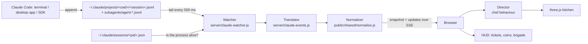

# 🍣 Agent Kitchen — Overcooked for Claude Code

**A live, Overcooked-style 3D kitchen that shows what every Claude Code agent on your machine is doing.**

Every Claude Code session becomes a **chef**. Every prompt you send becomes an **order ticket**. As the agent reads code, edits files, builds, runs tests, commits and pushes, its chef dashes between kitchen stations — grabbing nori, chopping fish, cooking rice, frying tempura, plating sushi and sending it out through the serving hatch. Failed builds and tests set stations on **fire** 🔥, sub-agents show up as **sous-chefs**, and every served order earns **coins**.


- **Zero install.** Plain Node.js (≥ 20), no `npm install`, no build step. three.js is vendored.
- **Watches all local Claude Code activity** — terminal sessions, the desktop app and SDK clients all write transcripts to `~/.claude/projects`, and the kitchen tails every session live.
- **Read-only and local.** It never writes to your Claude folder, and the server only listens on `127.0.0.1`.
- **Demo shift** built in, so you can see it in action without any agents running.

> **What counts as "Claude Code activity"?** Every session that runs on this machine: Claude Code in a terminal, the desktop app and Agent SDK clients all record transcripts under `~/.claude/projects`, and running processes register themselves in `~/.claude/sessions`. Sessions that run on Anthropic's machines (cloud sessions) leave nothing local, so they aren't shown.

> Inspired by the *Overcooked!* games (Ghost Town Games / Team17). This is an unofficial fan-made tribute: all art is original and generated procedurally in code — no game assets are used.

---

## Quick start

```sh
git clone https://github.com/thezem/overcooked-claude
cd overcooked-claude
npm start            # opens http://127.0.0.1:7425 in your browser
```

That's it. Leave it running in a corner of your screen (or on a second monitor) and work with Claude Code as usual — chefs clock in as sessions start.

| Command | What it does |
|---|---|
| `npm start` | Start the kitchen and open the browser |
| `npm run serve` | Start the kitchen without opening a browser |
| `npm run demo` | Start the server and open a simulated **demo shift** |
| `npm test` | Run the test suite (unit + integration, no dependencies) |
| `npm run screenshots` | Regenerate the screenshots in `docs/screenshots` |
| `node scripts/e2e-claude.js` | End-to-end check: a fake `~/.claude`, the real server and a real browser; screenshots land in `docs/e2e/` |

No server? Serve the `public/` folder from any static web server and add `?demo` — demo mode runs entirely in the browser.

## How the kitchen maps to the SDLC

Just like a sushi order — grab nori, cook rice, cut fish, plate it, ship it — an agent's turn flows through the kitchen:


| | Kitchen station | SDLC work | What triggers it |
|:---:|---|---|---|
| 📕 | **Recipe Book** | Plan & think | long thinking pauses, todos (`sql`), memory, skills, delegating to sous-chefs |
| 🟩 | **Nori Crate** | Read code | `view`, `cat`, `Get-Content`, `git diff/log/status/show` |
| 🐟 | **Fish Crate** | Search code | `grep`, `rg`, `glob`, code search, `Select-String` |
| 📦 | **Delivery Hatch** | Research | `web_fetch`, `web_search`, MCP servers (GitHub, Slack, …), `gh api`, `curl` |
| 🌾 | **Pantry** | Install dependencies | `npm install`, `pip install`, `dotnet restore`, `go mod`, `cargo add` |
| 🔪 | **Chopping Board** | Write code | `edit`, `create`, `apply_patch` |
| 🍚 | **Rice Cooker** | Build | `npm run build`, `tsc`, `dotnet build`, `cargo build`, `make`, `docker build` |
| 🍤 | **Tempura Fryer** | Run tests | `npm test`, `pytest`, `go test`, `dotnet test`, `node --test`, UI checks |
| 🚰 | **Sink** | Lint & format | `eslint`, `prettier`, `ruff`, `dotnet format`, context compaction |
| 🍣 | **Plating Counter** | Commit | `git add`, `git commit`, `merge`, `rebase`, `stash` |
| 🛎️ | **Serving Hatch** | Ship | `git push`, `gh pr create`, `create_pull_request`, `task_complete` |
| 🥣 | **Prep Station** | Run commands | any other shell command, scripts, dev servers |
| 🗑️ | **Bin** | Delete & revert | `rm`, `Remove-Item`, `git reset/clean/restore`, deleting files in a patch |
| 🔔 | **Order Bell** | Ask the user | `ask_user`, permission prompts — the chef waits with a **?** |

Shell commands are classified by parsing each segment of the command line (`a && b; c | d`), so `npm install && npm test` goes to the fryer and `git add -A && git commit && git push` goes to the serving hatch — the "furthest along" step wins. The full catalog lives in [`public/shared/stations.js`](public/shared/stations.js) and is covered by more than 100 tests.

### Claude Code tools → stations

| Claude Code | Station |
|---|---|
| `Read` | Nori Crate |
| `Grep`, `Glob`, `LSP` | Fish Crate |
| `Edit`, `Write`, `NotebookEdit` | Chopping Board |
| `Bash` | by command: `npm test` → Fryer, `npm run build` → Rice Cooker, `git commit` → Plating Counter, `git push` → Serving Hatch, anything else → Prep Station |
| `WebFetch`, `WebSearch`, MCP tools | Delivery Hatch (browser MCP tools → the Fryer, as taste-testing) |
| `TodoWrite`, `Skill`, `ToolSearch`, `Agent` | Recipe Book (an `Agent` call also brings in a **sous-chef**) |
| `AskUserQuestion` | Order Bell |

A tool result with `is_error` (or a Bash `Exit code N`) at a build, test, lint, install, commit or push station sets it on fire. An assistant turn that ends (`end_turn`) serves the order; `[Request interrupted by user]` cancels it.

### Order tickets


Each ticket is one prompt you sent. It shows the chef's colour and session, the prompt, the **ingredients** (stations) the order has passed through, a step counter, and a patience timer that runs from green to red over ten minutes. The dish levels up as the work progresses: **Miso Soup → Sashimi → Maki Roll → Tempura → Bento Box → Omakase**. When the agent finishes, the ticket is stamped ✓ and flies off; if you cancel, it's stamped ✗.

### Serving, coins and fires


Every served order is worth **20 coins** plus a speed tip (up to +8 when it's done within a minute). Cancelled orders cost 10. The counter in the bottom-left adds up today's orders across all sessions (change the window with `--since`).


A failed build, test, install, lint, commit or push — a tool error or a non-zero exit code — sets that station **on fire**. The chef panics, grabs the extinguisher and puts it out before carrying on. A failed read or edit is just a puff of smoke.

### Sous-chefs


When an agent delegates to a sub-agent (the `task` tool — explore, research, code-review, …), a smaller **sous-chef** in a bandana runs in through the front door in the head chef's colour, works its own stations, and heads out when it's done.

### Up close

| Prep side | Cooking side |
|---|---|
|  |  |

## Panels

**Brigade** (`B`) lists every chef with its repo, branch, client (app/cli), model and what it's doing right now. Click a chef — in the list or in the kitchen — to see its open orders and recent steps with ✓/✗ results.


**Menu** (`M`) is the in-game legend for every station.


**Settings** toggle station labels, chef chatter (speech bubbles with what the agent says), kitchen sounds, and **Hide prompts**.


### Privacy mode

Prompts can contain anything. Turn on **Hide prompts** (or add `?privacy=1`) before sharing your screen: prompt text, session names (Claude Code often titles sessions after your first prompt), file names, branches and chatter are replaced with generic labels, while the kitchen keeps cooking.


### Watching one repository

Add `?repo=owner/name` to only show sessions working in one repository. Here's this very project being built, live, with prompts hidden:


## Options

```text
node server/index.js [options]

  --port <n>          Port to listen on (default 7425, or $PORT)
  --host <addr>       Interface to bind (default 127.0.0.1; use 0.0.0.0 to share on your LAN)
  --open              Open the kitchen in your default browser
  --demo              Open the browser in demo mode (simulated agents)
  --claude-dir <dir>  Claude config folder (default $CLAUDE_CONFIG_DIR or ~/.claude)
  --since <when>      Count coins/orders since: today (default), all, 30m, 4h, 2d, or a date
  --recent <minutes>  Keep recently finished sessions in the roster this long (default 20)
  --poll <ms>         How often to check for new events (default 500)
```

URL parameters:

| Parameter | Effect |
|---|---|
| `?demo` | Simulated shift (works without the server). Also `&chefs=0..5`, `&speed=2`, `&seed=42`, `&prefill=0` |
| `?repo=owner/name` | Only show sessions in one repository |
| `?privacy=1` | Hide prompts, session names, file names and chatter |
| `?labels=0` / `?chatter=0` / `?sound=1` | Toggle station labels, speech bubbles, sounds |
| `?quality=low` | Lower resolution and shadow quality for slower machines |
| `?nointro` | Skip the "Ready? Go!" banner |

Keyboard: `M` menu · `B` brigade · `Esc` close panels and deselect.

## Privacy & security

- The server reads `~/.claude/projects/**/*.jsonl` (including `subagents/`) and `~/.claude/sessions/*.json` **read-only** and keeps everything in memory.
- It binds to `127.0.0.1` by default, rejects requests whose `Host` header isn't local (DNS-rebinding protection), sends a strict Content-Security-Policy, and only serves files from `public/`.
- Nothing is sent anywhere: the page loads no external resources.
- If you bind to another interface with `--host`, anyone who can reach that port can see your prompts.

## How it works



The translator turns each transcript line (a prompt, an assistant `tool_use`, a `tool_result`, an interrupt, …) into a small event such as `user.message`, `tool.execution_start/complete`, `subagent.started` or `abort`. The normalizer turns those events into kitchen state and one-shot effects (order placed, tool started, fire, order served). The browser's **director** queues each chef's steps, walks them to the right station with A* pathfinding, and plays the matching animation for at least a moment, so quick steps stay visible without falling behind real time.

See **[docs/ARCHITECTURE.md](docs/ARCHITECTURE.md)** for the event model, station classification, chef state machine and how to extend the kitchen.

## Development

```text
server/          Node server: CLI, Claude transcript watcher + translator, JSONL tailer, HTTP + SSE
public/          The browser app (static; works from any web server in demo mode)
  shared/        Station catalog + event normalizer, shared by server and browser
  js/scene/      three.js: world, kitchen layout, stations, chefs, particles
  js/            Director, HUD, panels, demo shift, live connection
  vendor/        three.js (MIT), bundled
  fonts/         Fredoka (SIL OFL)
scripts/         Headless screenshots via the Chrome DevTools Protocol, plus the Claude end-to-end check
test/            node:test suites
docs/            Architecture notes and screenshots
```

- `npm test` runs the whole suite in about a second.
- `node scripts/shot.js <url> out.png [--wait ms] [--eval js]` takes a headless screenshot with Edge or Chrome and fails on any page error — handy for checking visual changes.
- `npm run screenshots` regenerates the docs images from a demo shift (against an empty temp state folder, so no real sessions leak into them). Add `-- --live owner/repo` to also capture `live.png` with prompts hidden.

## Credits

- Built on [patniko/overcooked-agents](https://github.com/patniko/overcooked-agents) (the kitchen, director and scene); this fork replaces its data layer with a Claude Code one.
- Concept inspired by **Overcooked!** and **Overcooked! 2** by Ghost Town Games, published by Team17. Not affiliated with or endorsed by them.
- [three.js](https://threejs.org) — MIT License.
- [Fredoka](https://github.com/hafontia/Fredoka-One) font — SIL Open Font License 1.1.
